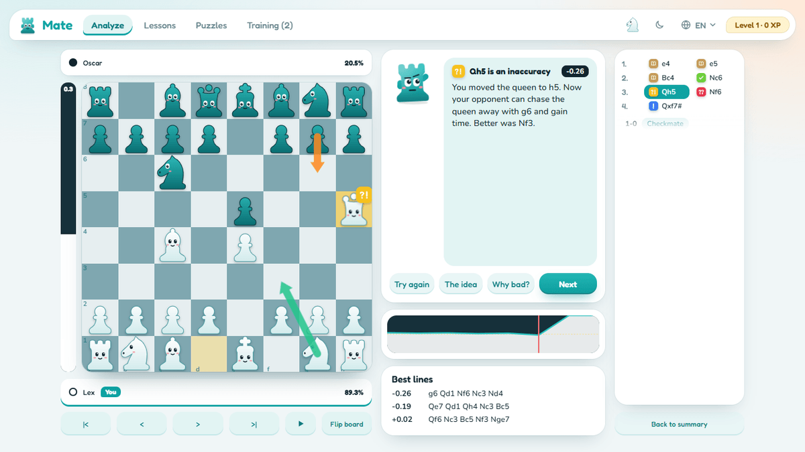
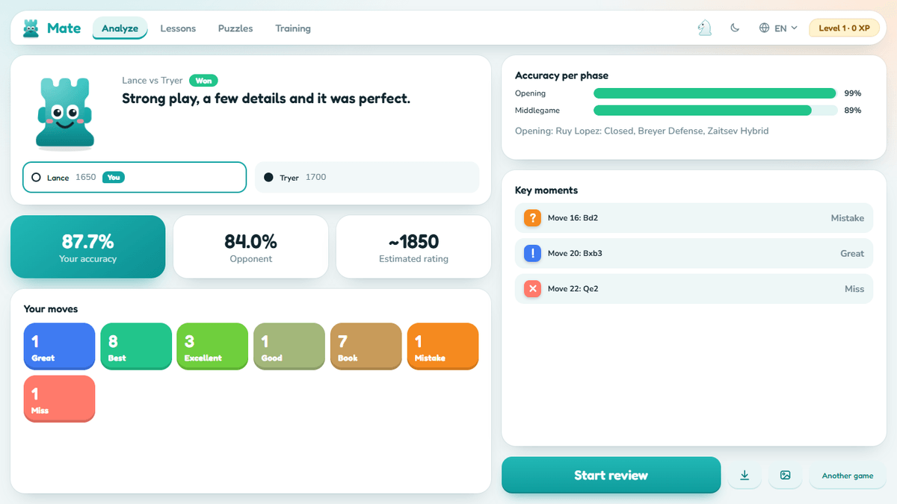
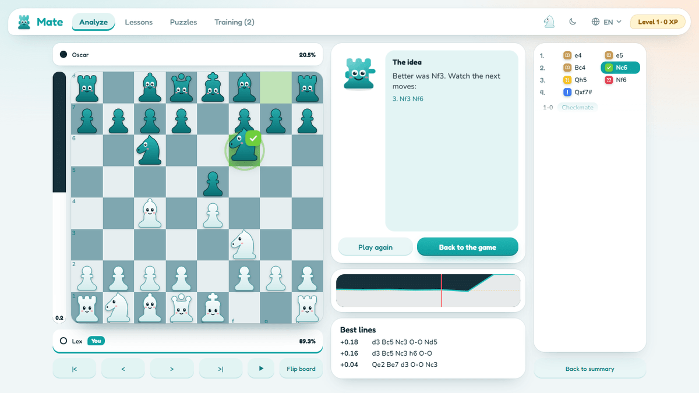
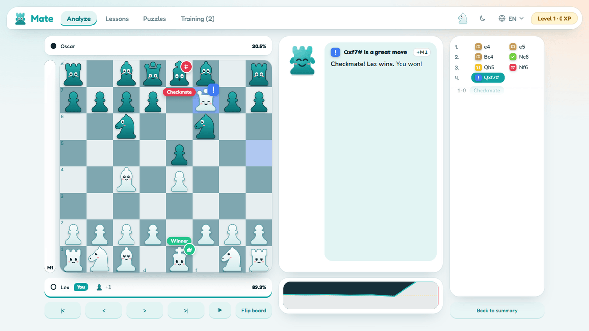
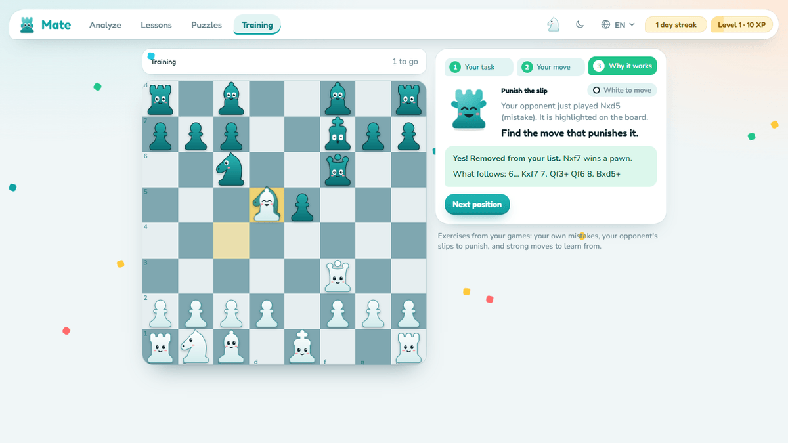
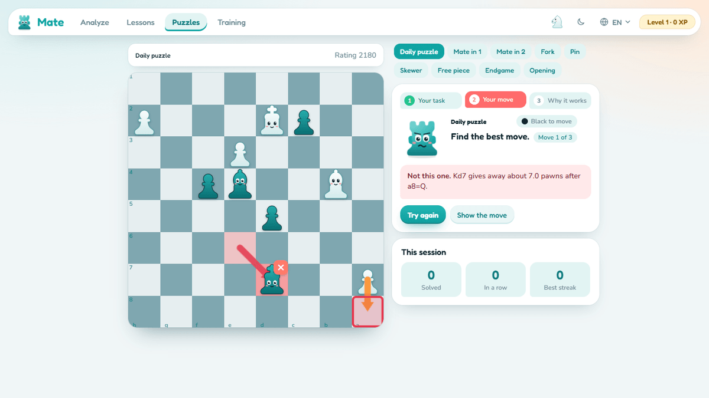
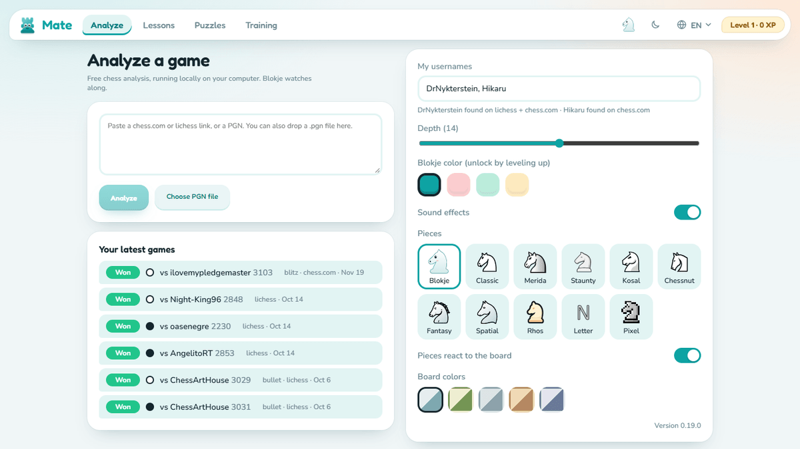
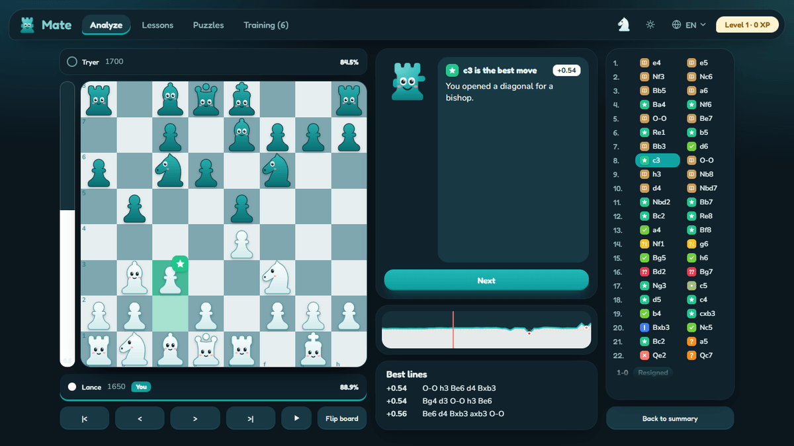

<p align="center">
  
</p>

<h1 align="center">Mate</h1>

<p align="center">
  <b>A chess coach that sits next to your board, for free.</b><br>
  Finish a game on chess.com, lichess or Duolingo, press <b>Check with Mate</b>, and Blokje walks you through it:
  what every move did, what was better, why, and what would have happened next. Stockfish runs on your own computer.
</p>

<p align="center">
  <a href="https://github.com/lexvanwalsem/mate/actions/workflows/test.yml"></a>
  
  
  
  
  
  
</p>

<p align="center">
  
</p>

In Dutch the app is called **Zetje** ("a little move"), in English **Mate**: your chess mate, and a nod to checkmate.

## The problem

A good game review tells you more than "inaccuracy, -0.26". You want to know what the move did, what the other side
can do now, what you should have played, and what that better move leads to. On most sites the full review is behind a
subscription, and free tools mostly give you numbers and engine lines.

Mate gives you the coach part for free, on your own computer, for the games you already play.

## What Mate does

- **One click from your game.** A **Check with Mate** button sits on chess.com, lichess and the Duolingo Chess match list.
  Press it after a game and the analysis opens in a new tab.
- **A coach that talks to you.** Every move gets a headline ("Qh5 is an inaccuracy") with the evaluation, and a
  sentence that explains it from the side at the bottom of the board: "You made a quiet move with the queen. Now your
  opponent can chase it away with g6 and gain time. Better was Nf3."
- **Arrows that go with the words.** Green for the better move, orange for the answer that punishes you, yellow for a
  new attack, red for a piece left hanging, teal for the plan a few moves ahead.
- **See the idea, not only the move.** **The idea** plays the better move and the next moves on the board, one per
  second. **Why bad?** plays how a mistake gets punished.
- **The end of the game is clear.** A crown on the winner's king, the reason on the loser's (checkmate, time out,
  resigned, stalemate, draw), and the coach says it in words.
- **Learn from your own games.** Your mistakes, your opponent's slips and their strong moves become training positions.
- **Lessons and puzzles** in the same calm three-step flow: your task, your move, why it works.

## Where it reads games from

| Site | What works |
|---|---|
| **chess.com** | Live and daily games, games against bots (`/game/computer/...`), the review page of a game. Your latest games from your username. |
| **lichess** | Every game page, your latest games from your username. |
| **Duolingo Chess** | Every match on duolingo.com/chess-matches gets a **Check with Mate** button. The toolbar button analyzes your latest match. |
| **Anything else** | Paste a PGN or a game link, drop a `.pgn` file, select a PGN on any page and use the right-click menu. |

chess.com stores bot games in its own compact move format (TCN); Mate decodes it, so you get the real names and every
move. Duolingo keeps your matches behind your login and stores moves as UCI; Mate reads them through the page you are
already logged in to.

## Why use it

| You want to know | A plain engine | Mate |
|---|---|---|
| Was this move good? | A number, maybe a symbol | A headline, a class (Brilliant to Blunder) and a sentence on what the move did |
| What should I have played? | A line of moves | "Better was Nf3", a green arrow, and **The idea** plays it out on the board |
| Why is my move bad? | The evaluation drops | "This allows Nxe5, which wins a pawn", with the punishing move as an orange arrow, and **Why bad?** plays it |
| What was the plan? | A long engine line | "The idea: after 22. axb5 Qc7 23. c4 you win a pawn", the line read until the position is calm |
| Does it still matter? I was lost anyway | Every move scores the same | "From here it was already mate in 3 for your opponent. Still, keep your pieces safe: your opponent can still miss the mate." A hung rook is still a blunder |
| What if they had played something else? | Set up the position yourself | Drag any piece, for either side, and the engine judges your own line live |
| How do I get better? | Nothing | Your mistakes become training positions, plus lessons and puzzles |

## What you get

### A summary you understand at a glance

Accuracy for both players, an estimated rating, the count of every move class, accuracy per game phase, the opening,
time per move from the clocks, and the key moments to jump to. Pick which player you are with one click.

<p align="center">
  
</p>

### A review that explains

The board, a roomy coach column and the move list side by side. The coach speaks to the player at the bottom of the
board; flip the board to hear the other side. Special moves get a label on the board (Great!, Castles, Check), captured
pieces and the material lead show next to each player, and **Next** is always one big button away.

### The idea behind the better move

<p align="center">
  
</p>

### A clear ending

<p align="center">
  
</p>

### Training from your own games

Every game you review leaves exercises behind: your own mistakes ("find a better move than Nf1"), your opponent's slips
("punish it") and their strong moves ("find it yourself"). A wrong try stays on the board with arrows and an explanation
until you press **Try again**. After the right move, **Show what follows** plays the engine's continuation.

<p align="center">
  
</p>

### Puzzles and lessons

Puzzles come live from the free Lichess puzzle database (daily puzzle, mate in 1 and 2, forks, pins, skewers, endgames).
A puzzle starts one move earlier, so you first see the opponent's move. Pieces glide, a green or red sign lands on the
board at your move, and the opponent answers calmly with a note. Seventeen short lessons teach the pieces, checkmates
and tactics.

<p align="center">
  
</p>

### Your latest games, one click away

Type your chess.com or lichess name and the start page lists your newest games: result, opponent, rating, speed and
date. Under the field it says on which site each name was found.

<p align="center">
  
</p>

### Blokje

Blokje is a little rook with big eyes that follow your mouse. He cheers at a brilliant move, worries at a blunder and
falls asleep when there is nothing to do. The Blokje piece set is drawn in his style, and with **Pieces react to the
board** on, a king in check gets a fright, a loose piece worries and the piece that just captured is happy. Prefer
classic pieces? Ten sets and five board colours are in the knight menu in the header, on every screen.

<p align="center">
  
</p>

### And more

- Draw on the board: right-drag an arrow, right-click a square (shift red, alt yellow, ctrl green).
- Dark mode, sound effects, a daily XP goal, levels and streaks, Blokje colours you unlock by playing.
- Export the game as an annotated PGN, or save the summary as an image.
- Dutch and English, following your browser language.

## Install

Mate is not in the Chrome Web Store yet. Build it and load it as an unpacked extension (takes a few minutes):

```bash
npm install
npm run build
```

1. Open `chrome://extensions` and switch on **Developer mode**.
2. Click **Load unpacked** and select the `dist` folder.
3. Pin the extension (puzzle icon, then the pin) so Blokje stays in your toolbar.

After a new build, press the refresh icon on the extension card. The version on the card and at the bottom of the
settings tells you which build is running.

## Use

1. Finish a game on chess.com or lichess, or open duolingo.com/chess-matches.
2. Press **Check with Mate** (or the Blokje icon in the toolbar).
3. Read the summary, press **Start review**, and walk through the game with **Next**.
4. On a move you want to understand: **The idea**, **Why bad?**, or drag a piece to try your own line.
5. Open **Training** later to practise the positions from your games.

Tip: put your chess.com and lichess usernames on the start page. Mate then knows which side you played and shows your
latest games.

## Built to be trusted

- **Your games stay on your computer.** Stockfish runs in your browser as WebAssembly. No server, no account, no
  analytics.
- **It only talks to the sites it reads games from**: lichess, chess.com and Duolingo, to fetch the game you asked for,
  plus the Lichess puzzle API for puzzles. Duolingo is read through your own logged-in page; Mate never sees your password.
- **Honest about what it knows.** The explanations come from rules on top of the engine's lines. When a position was
  already decided, the coach says so instead of pretending a move mattered.
- **Tested.** Logic checks and end-to-end tests drive the built extension in a real Chrome, from loading a game to the
  last move.

### Why these permissions

| Permission | Used for |
|---|---|
| `activeTab`, `scripting` | The toolbar button reads the game from the page you are on (or looks for a PGN or game link on other sites). |
| `contextMenus` | "Check with Mate" in the right-click menu for a selected PGN. |
| `lichess.org`, `www.chess.com`, `api.chess.com` | Fetch the game you open and your latest games, and show the button on those sites. |
| `www.duolingo.com` | Show the button on your Duolingo Chess matches and read the match you click. |

## How it works

The content script finds the game on the page (or Duolingo's own match list), the background worker opens the analysis
page, and the page fetches the PGN. Stockfish evaluates every position. The move classes follow
[Chesskit](https://github.com/GuillaumeSD/Chesskit): how much win chance a move gave away. On top of that Mate adds:

- **A material check.** Win chance cannot see a hung piece once a game is decided (being mated in five or in two is
  0% either way). Mate compares the played move with the best move: what can be taken right away, and the material once
  the engine lines are played out until calm. A piece lost on top of the best move is a mistake, a rook or more a blunder.
- **Explanations.** chess.js and the engine lines tell what a move does: castling, a capture (free, a trade or risky),
  check, development, space, open files, a new attack, a piece left hanging, and what the engine's answer achieves.
- **Plans.** The engine line is played until no more pieces are taken; if one side comes out ahead or mates, that is the
  idea the coach describes.
- **Game endings.** From the final position (checkmate, stalemate) and the result and termination the site wrote down.

## Limits

- The explanations are rules on top of an engine, not a human coach: deep strategic plans ("prepare a kingside attack")
  are out of reach. When a move fits no rule, Blokje calls it a quiet move.
- Depth is set on the start page; deeper is better and slower. A long game at the default depth takes a minute or two.
- Duolingo's match pages and API are not documented. If Duolingo changes them, the buttons may stop appearing.
- chess.com sometimes blocks automated traffic; in your own browser that is normally not a problem.
- Analysis runs on one CPU thread, so it is slower than the site's own servers.

## Development

```bash
npm run dev          # the app in a browser tab
npm run build        # icons, app and extension into dist/
npm run typecheck
```

Logic checks run in Node: `check:lessons`, `check:reactions`, `check:material`, `check:duolingo`, `check:tcn`,
`check:chesscom-bot` (needs internet). End-to-end tests drive the built extension in a headless Chrome:

```bash
node scripts/test-ending.mjs "<path to chrome.exe>" "<absolute path to dist>"
```

The same goes for `test-ext`, `test-explore`, `test-practice`, `test-train`, `test-puzzle`, `test-style`,
`test-clocks`, `test-online`, `test-duolingo` (against a stand-in page, no login), `test-fit` (every screen fits
without scrolling, `DARK=1` for dark mode) and `test-audit` (no clipped text, both languages).

| Folder | Role |
|---|---|
| `src/extension/` | Content scripts (chess.com, lichess, Duolingo) and the background worker |
| `src/engine/` | Stockfish pool, win chance, accuracy, move classification, rating estimate |
| `src/lib/` | Loading games (`sources`, `tcn`, `duolingo`, `recentGames`), the analysis, explanations (`explain`, `materialLoss`, `gameEnd`), training, puzzles, lessons, settings, texts (`i18n`) |
| `src/screens/` | Start page, summary, review, lessons, puzzles, training |
| `src/ui/` | Board, Blokje, task card, player bars, charts |
| `scripts/` | Piece and icon generators, logic checks and end-to-end tests |
| `public/` | Manifest, locales, icons, piece sets, sounds, Stockfish builds |

The code and comments are in English, the interface is Dutch and English.

## Contributing

Contributions are welcome as pull requests. The `main` branch is protected: every change is reviewed and approved by the
maintainer before it is merged, and the tests must pass. See [CONTRIBUTING.md](CONTRIBUTING.md). To report a security
problem, see [SECURITY.md](SECURITY.md).

## Credits and license

**Mate is a modified version of [Chesskit](https://github.com/GuillaumeSD/Chesskit)** by GuillaumeSD, a free chess
analysis web app. Mate takes Chesskit's engine helpers (move classification, accuracy, win chance, rating estimate),
its openings data, the Stockfish build and most piece sets, and turns them into a browser extension with its own
interface, coach, explanations, training, lessons, puzzles and mascot. The files that come from Chesskit say so at the
top. Thank you, Guillaume.

Also inside: [Stockfish](https://github.com/official-stockfish/Stockfish) through
[Stockfish.js](https://github.com/nmrugg/stockfish.js) (GPL-3.0), piece sets by Colin M.L. Burnett, Armando Hernandez
Marroquin, sadsnake1, Alexis Luengas, Maurizio Monge, RhosGFX, usolando and therealqtpi,
[React](https://react.dev), [chess.js](https://github.com/jhlywa/chess.js) and the fonts
[Fredoka](https://fonts.google.com/specimen/Fredoka) and [Nunito](https://fonts.google.com/specimen/Nunito). Puzzles
come live from the [Lichess puzzle database](https://database.lichess.org/#puzzles) (CC0). Reading Duolingo matches
follows [duolingo-chess-history](https://github.com/JohnVitor-Dev/duolingo-chess-history) by John Vitor (MIT).

Mate is licensed under the [AGPL-3.0](LICENSE), like Chesskit. [THIRD-PARTY.md](THIRD-PARTY.md) lists every file and
asset that comes from elsewhere, with its author and license.
